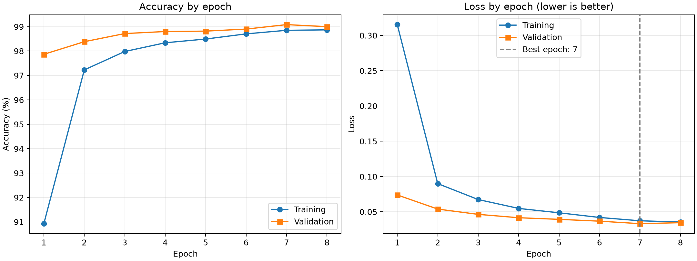
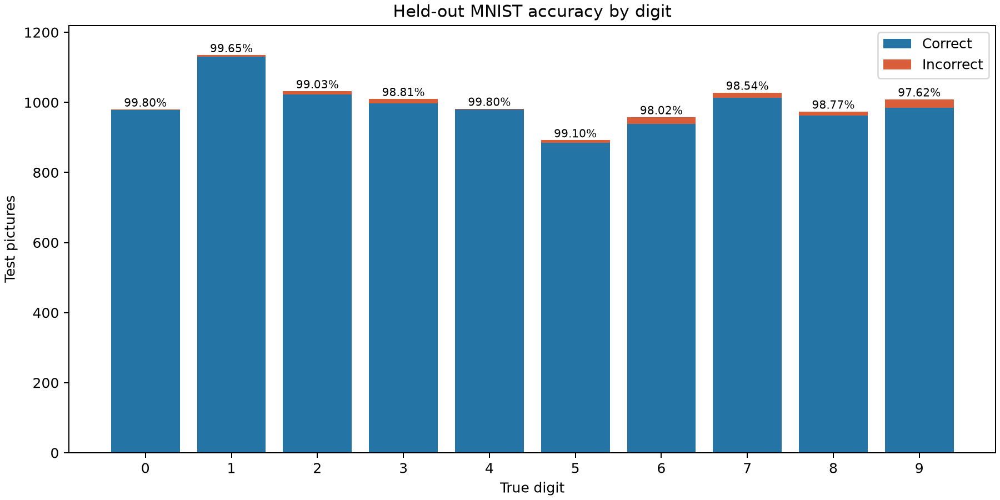
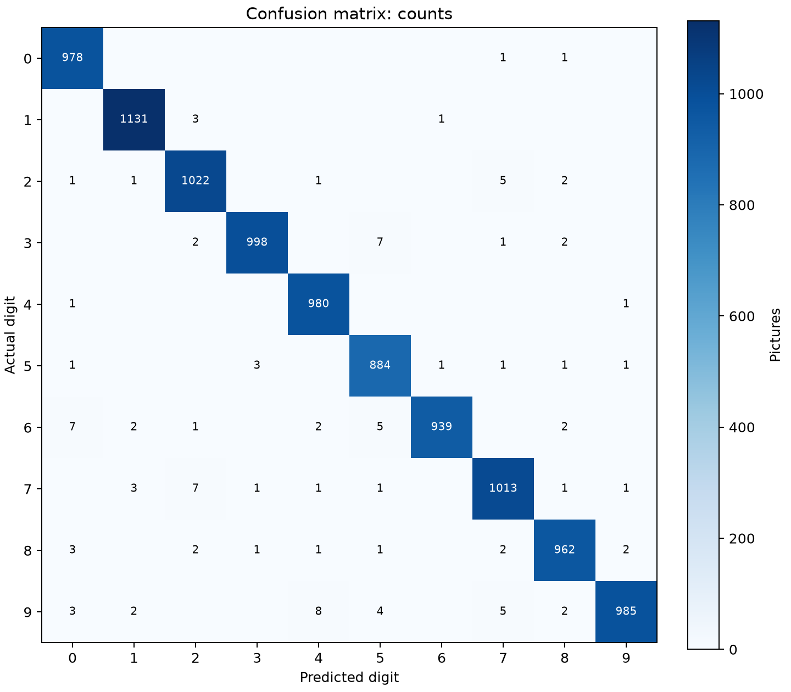
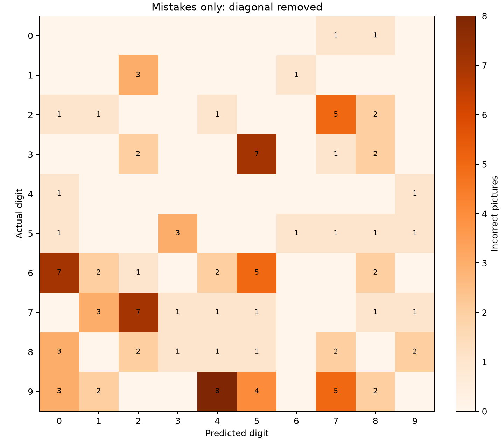
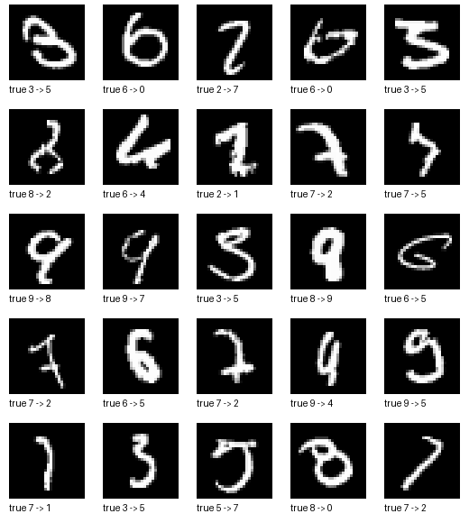
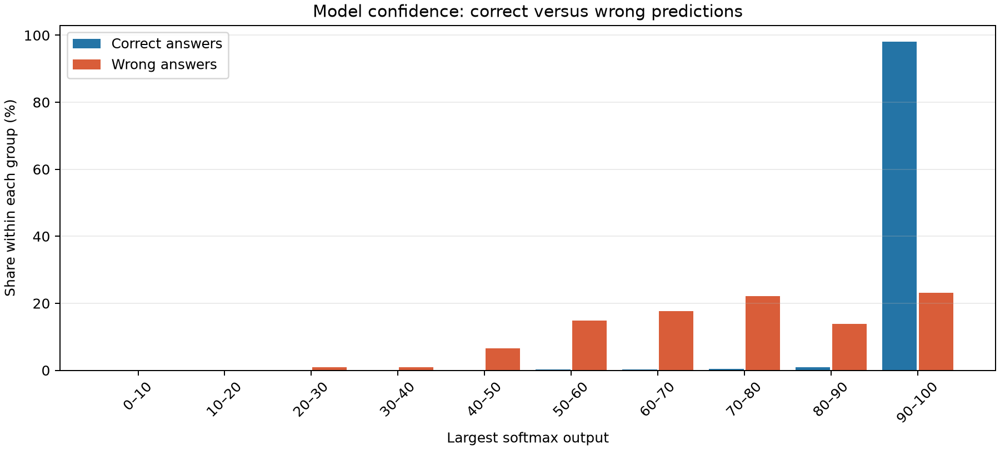
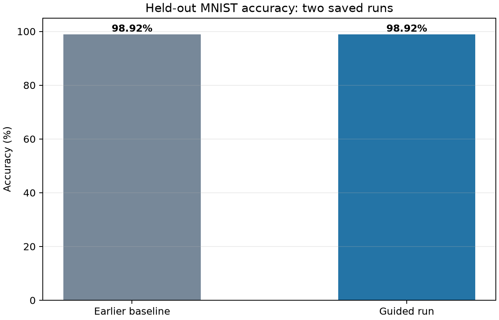

# MNIST model evaluation

This report records the MNIST training run, held-out test results, error analysis, and research review. Implementation decisions are summarized in `DEVELOPMENT_LOG.md`. **8 October update:** a later seven-writer handwriting pilot is documented separately in [the model and experiment record](../docs/MODEL_AND_EXPERIMENTS.md). Its fine-tuned candidate was not adopted; the MNIST results below still describe the guided original.

## 1. Scope and data

The task is to classify a 28 × 28 grayscale image as digit 0–9. MNIST supplies 60,000 labelled training-set images and a separate 10,000-image test set. The training run used 54,000 images for weight updates and reserved 6,000 from the training set for validation. The test set was evaluated only after the model had been trained and saved. Its labels did not update model weights.

Images were converted from integer pixels 0–255 to `float32` pixels 0–1. A one-channel dimension changed their shape to `(28, 28, 1)`. Labels stayed as integer digit IDs.

## 2. Model and settings

| Item | Value and meaning |
| --- | --- |
| Architecture | Conv2D(32) → MaxPooling → Conv2D(64) → MaxPooling → Flatten → Dropout(0.25) → Dense(10, softmax) |
| Trainable parameters | 34,826 adjustable values |
| Optimizer | Adam, learning rate 0.001; adjusts weights after each batch |
| Loss | Sparse categorical cross-entropy; lower means predicted probability was closer to the correct digit |
| Batch size | 128 images per weight update |
| Maximum epochs | 8 full passes through the training subset |
| Random seed | 42, to make the run more repeatable |
| Early stopping | Monitored validation loss, patience 2, restored the best weights |
| Hardware | Native Windows CPU; TensorFlow reported no GPU support for this environment |

## 3. Training results

| Epoch | Training accuracy | Training loss | Validation accuracy | Validation loss |
| ---: | ---: | ---: | ---: | ---: |
| 1 | 90.93% | 0.3154 | 97.87% | 0.0739 |
| 2 | 97.23% | 0.0900 | 98.38% | 0.0539 |
| 3 | 97.98% | 0.0674 | 98.72% | 0.0464 |
| 4 | 98.34% | 0.0548 | 98.80% | 0.0416 |
| 5 | 98.49% | 0.0486 | 98.82% | 0.0393 |
| 6 | 98.70% | 0.0420 | 98.90% | 0.0367 |
| 7 | 98.85% | 0.0373 | 99.08% | 0.0332 |
| 8 | 98.87% | 0.0355 | 99.00% | 0.0346 |

The lowest validation loss was **0.0332 at epoch 7**, when validation accuracy was **99.08%**. Epoch 8's validation loss increased slightly, so the saved model uses the restored epoch 7 weights. Validation accuracy can be higher than training accuracy because dropout is active during training and inactive during validation; the two numbers are measured under different conditions.



**How to read the graph:** both losses generally decreased while accuracy increased. The small late rise in validation loss is why saving the best weights matters. This graph alone cannot prove performance on phone photos or personal handwriting.

## 4. Held-out MNIST test results

| Measure | Result |
| --- | ---: |
| Test images | 10,000 |
| Correct predictions | 9,892 |
| Incorrect predictions | 108 |
| Test accuracy | **98.92%** |
| Test loss | 0.0327 |

The percentage describes this **MNIST test set**. It is not a measured accuracy for photos, drawings in the future app, or handwriting from our team.

### Accuracy by digit

| True digit | Correct | Incorrect | Total | Accuracy |
| ---: | ---: | ---: | ---: | ---: |
| 0 | 978 | 2 | 980 | 99.80% |
| 1 | 1131 | 4 | 1135 | 99.65% |
| 2 | 1022 | 10 | 1032 | 99.03% |
| 3 | 998 | 12 | 1010 | 98.81% |
| 4 | 980 | 2 | 982 | 99.80% |
| 5 | 884 | 8 | 892 | 99.10% |
| 6 | 939 | 19 | 958 | 98.02% |
| 7 | 1013 | 15 | 1028 | 98.54% |
| 8 | 962 | 12 | 974 | 98.77% |
| 9 | 985 | 24 | 1009 | 97.62% |



Digit 9 had the lowest accuracy (97.62%), followed by digit 6 (98.02%). Class sizes differ, so compare both percentages and counts.

### Precision, recall, and F1

**Recall** asks: of the images that truly show a digit, how many did we find? Here it equals the per-digit accuracy above. **Precision** asks: when the model predicts a digit, how often is that prediction correct? **F1** combines both into one number. These are useful when a model predicts one digit too often or misses it too often.

| Digit | Precision | Recall | F1 |
| ---: | ---: | ---: | ---: |
| 0 | 98.39% | 99.80% | 99.09% |
| 1 | 99.30% | 99.65% | 99.47% |
| 2 | 98.55% | 99.03% | 98.79% |
| 3 | 99.50% | 98.81% | 99.16% |
| 4 | 98.69% | 99.80% | 99.24% |
| 5 | 98.00% | 99.10% | 98.55% |
| 6 | 99.79% | 98.02% | 98.89% |
| 7 | 98.54% | 98.54% | 98.54% |
| 8 | 98.87% | 98.77% | 98.82% |
| 9 | 99.49% | 97.62% | 98.55% |

The unweighted average F1 across the ten digits was **98.91%**. It gives each digit equal importance, while overall accuracy gives each individual picture equal importance.

### Where the model confused digits

The confusion matrix has true digits on rows and predicted digits on columns. Its diagonal counts correct predictions. The second plot removes that diagonal so smaller error patterns are visible.





The five largest directed confusions in this run were:

| Actual digit | Predicted digit | Pictures |
| ---: | ---: | ---: |
| 9 | 4 | 8 |
| 7 | 2 | 7 |
| 6 | 0 | 7 |
| 3 | 5 | 7 |
| 9 | 7 | 5 |

These counts describe MNIST examples only. To inspect shapes behind the numbers, open the sheet below. It shows the first 25 incorrect test images in dataset order, labelled `true → predicted`; it is a set of examples, not a random sample.



### How confident was the model?

The mean largest softmax output was **99.29%** for correct answers and **73.93%** for wrong ones. **25 of the 108 wrong predictions** still had a largest output of at least 90%. The plot divides each group into ten confidence bands; it uses percentages within each group because correct answers greatly outnumber mistakes.



This score is useful for comparing model outputs, but it is not proof that a stated 90% is correct 90% of the time. We have not calibrated confidence, and the picture is based only on MNIST.

## 5. Comparison with the earlier saved run

| Saved run | MNIST test size | Test accuracy | Test loss |
| --- | ---: | ---: | ---: |
| Earlier baseline | 10,000 | 98.92% | 0.0328 |
| Current model | 10,000 | 98.92% | 0.0327 |

**Difference in reported test accuracy: +0.00 percentage points.** The current model matches the earlier saved baseline at the displayed precision. The baseline numbers were copied from the earlier project's `artifacts/metrics.json` into `reference_baseline_metrics.json`; this is a comparison of two saved runs, not a controlled study of a single change. The tiny loss difference should not be treated as meaningful evidence of improvement.



## 6. Interpretation, limits, and next decision

- The CNN learned MNIST well and reproduced the earlier 98.92% test accuracy.
- The current model used all 60,000 images in the standard MNIST training split. Other labeled handwriting datasets exist, but a larger count by itself does not show that those examples match our intended users.
- A phone photo or drawn digit can differ in background, thickness, position, size, lighting, and color from MNIST. The local app now prepares and displays these inputs, but the team still needs to try genuine handwriting.
- The displayed softmax value is a model output, not proof that the predicted probability is calibrated. An uncertain or wrong real-world image still needs visible handling in the app.
- At the time of this MNIST report, real-handwriting performance had not yet been measured. A later 140-crop pilot is recorded separately; it is exploratory and does not establish general real-world accuracy. Cloud deployment has still not been verified.

**Next action:** try the local app with labeled team examples, inspect original and prepared images, and decide whether the observed failures call for preprocessing changes, targeted augmentation, or more labeled examples. Keep the 10,000 MNIST test images out of training.

## 7. What published work and other builders found

This research review was completed on 5 October 2026. It covers the original MNIST/CNN work, later robustness and dataset studies, official dataset and TensorFlow documentation, and public troubleshooting discussions. Papers and maintained dataset/documentation pages are stronger evidence than individual forum reports; forum reports below are included as practical anecdotes, not controlled experiments.

### 7.1 Why CNNs and image distortions became standard

**LeCun, Bottou, Bengio, and Haffner (1998), “Gradient-Based Learning Applied to Document Recognition.”** This foundational work explains trainable convolutional networks for document tasks such as handwritten character recognition. The practical idea is to learn visual features from pixels instead of manually writing rules for every stroke. The original MNIST description also matters: the benchmark is already converted into small grayscale images with bounding-box normalization and centering. It is not a raw photograph benchmark. [Paper and author PDF](https://bottou.org/papers/lecun-98h), [MNIST dataset notes](https://yann.lecun.org/exdb/mnist/index.html)

**Simard, Steinkraus, and Platt (2003), “Best Practices for Convolutional Neural Networks Applied to Visual Document Analysis.”** The paper compared practical network choices on MNIST and emphasized CNNs and adding plausible distorted training examples. They studied transformations including shifts, rotations, skew, and elastic deformations, which approximate natural variation in handwriting. The purpose is to make the model tolerate label-preserving changes without collecting a new human-written sample for every small variation. This is useful precedent, but it does not mean every transformation helps every input style; changes that turn a digit into another digit would teach the wrong label. [Microsoft Research paper record and PDF](https://www.microsoft.com/en-us/research/publication/best-practices-for-convolutional-neural-networks-applied-to-visual-document-analysis/)

**TensorFlow's training and augmentation guides.** Their official Keras examples demonstrate distinct training, validation, and test roles. Their augmentation guide describes operations such as rotation, zoom, crop, and contrast, and says to apply random augmentation to training data only. It also explains an engineering choice: preprocessing inside the saved model can travel with that model; preprocessing outside it has to be reproduced consistently at prediction time. That matters for our app because the MNIST training path currently scales and reshapes images, while uploaded images also go through crop, contrast, inversion, and centering. [Training and evaluation guide](https://www.tensorflow.org/guide/keras/training_with_built_in_methods), [data augmentation guide](https://www.tensorflow.org/tutorials/images/data_augmentation)

### 7.2 Larger and more varied handwriting datasets

**EMNIST and NIST Special Database 19.** NIST describes EMNIST as handwriting derived from NIST Special Database 19 and converted into an MNIST-compatible 28 × 28 format. The EMNIST Digits split contains 280,000 balanced digit examples; NIST SD19 describes over 800,000 checked character images from 3,600 writers. These datasets exist to provide more writers and a broader character collection in a convenient format. They are candidates for later experiments if our own checks reveal missing handwriting variety. Their size alone does not guarantee a match to our team's writing or photo conditions; labels, split, preprocessing, and source should be documented. [NIST EMNIST page](https://www.nist.gov/itl/products-and-services/emnist-dataset), [NIST SD19 page](https://www.nist.gov/srd/nist-special-database-19), [EMNIST paper](https://arxiv.org/abs/1702.05373)

**HWD+ high-resolution handwritten digits study.** The authors collected about 13,580 digit images from 97 writers, recorded writer characteristics, and asked participants to write repeated digits using a controlled sheet and pen. They note that the volunteer group was smaller and not randomly sampled, so it cannot support broad population claims. Their 28 × 28 version enables direct MNIST-style experiments. Their comparison found higher-resolution images could improve some classification results, but training one CNN on 100 × 100 images took about 25 times as long as on low-resolution images. The lesson for our project is to record how examples were collected and balance realism against cost; a higher resolution is not automatically worth that cost for this small demo. [HWD+ study](https://pmc.ncbi.nlm.nih.gov/articles/PMC9702948/)

**Kannada-MNIST and its Dig-MNIST set.** This project released a drop-in Kannada numeral dataset plus a separate 10,000-image real-world test set. Its baseline CNN scored 96.8% on the main test set and 76.1% on Dig-MNIST. Those numerals use a different script, so these scores cannot be compared directly with our Arabic-digit MNIST result. The useful part is the study design: make a separate evaluation set from a different collection process to expose a domain shift that an in-domain test can hide. [Kannada-MNIST paper](https://arxiv.org/abs/1908.01242)

### 7.3 Image corruption and domain shift

**MNIST-C (Mu and Gilmer, 2019).** This benchmark applies 15 broad image corruptions to MNIST test images, including noise, blur, brightness, pixelation, and elastic changes. The paper reports that a tested CNN's mean accuracy fell from 99.22% on clean MNIST to 91.21% on the corruption suite; it also reports that error increased by roughly a factor of ten. The authors show that training on the benchmark's held-out corruption conditions defeats the purpose of testing out-of-distribution robustness. For us, this supports testing real input conditions and keeping an evaluation set separate from augmentation experiments. The corruption benchmark is not the same thing as testing actual handwriting from our team. [MNIST-C paper](https://arxiv.org/abs/1906.02337)

### 7.4 What people reported when they tried their own writing

These are public self-reports, so they help generate troubleshooting ideas but do not establish general performance claims.

- In a Stack Overflow thread, one builder reported about 96% on MNIST but 80% on their own handwriting after cropping, resizing to 28 × 28, centering, and inverting the background. They described thinner strokes and contrast differences; their thresholding and contrast enhancement attempts did not solve the gap. The replies discussed normalizing training and test images consistently or adding representative target examples. This is a useful warning that resizing and inversion alone may not erase writer/style differences. [Thread and follow-up discussion](https://stackoverflow.com/questions/27925358/pre-processing-before-digit-recognition-for-nn-cnn-trained-with-mnist-dataset)
- In a newer Stack Overflow report about a canvas app and a Flask prediction service, the builder said their local MNIST accuracy was about 98% but deployed canvas predictions were often wrong. The post's follow-up identifies reversed foreground/background polarity: scaling values by 255 did not correct the inversion. The author reports that inverting the image and visually comparing saved preprocessed samples with MNIST resolved the issue. This directly supports showing the processed 28 × 28 image in our app. [Question, answer, and author's follow-up](https://stackoverflow.com/questions/79980878/cnn-digit-recognition-model-high-local-accuracy-but-poor-predictions-after-depl)
- A Reddit learner described roughly 98% MNIST test accuracy but unreliable predictions in a Tkinter drawing interface, particularly for 9, 7, and 1. Replies raised possible issues with drawing color, thresholding, and model setup; the discussion did not provide a controlled comparison, so treat those remedies as hypotheses. The practical theme is the same: benchmark accuracy and interactive-input accuracy are different measurements. [Discussion](https://www.reddit.com/r/learnmachinelearning/comments/t22q50/)

### 7.5 Takeaways for this project

1. **Inspect preprocessing visually before changing the CNN.** Our sample currently passes through the upload-preparation function and remains recognizable, but this is only one MNIST example. When using real images, compare the original and 28 × 28 processed version and inspect polarity, crop, centering, stroke thickness, and contrast.
2. **Keep the test conditions honest.** The 98.92% result is for the 10,000 held-out MNIST examples. Team handwriting should have its own separate labeled results. If there are enough writers, keep some writers out of the tuning examples; otherwise report simple counts and call the check exploratory.
3. **Prefer a targeted fix over indiscriminately making the dataset bigger.** Fix an inversion or crop problem in preprocessing. If clear inputs repeatedly fail because the writing differs, then consider representative new samples or gentle, label-preserving transformations. Generate them only from training data and inspect the transformed digits before training.
4. **Consider EMNIST Digits only as a candidate follow-up dataset.** It is larger and compatible in image size, but its source does not guarantee it matches our users. A comparison should use the same held-out real-handwriting set and report the outcome by input style and digit.
5. **Do not over-read a high softmax score.** Our own MNIST evaluation found 25 wrong predictions whose top score was at least 90%. The app therefore calls it a model score and displays alternatives rather than treating it as a guarantee.

These are research-informed options, not changes made to the guided model. A small labelled handwriting pilot was later run, with no improvement on its writer checks. A new-writer check would provide more independent evidence. Cloud hosting remains proposed rather than verified.

## 8. Reproduce the saved results and plots

From the repository root in the VS Code terminal:

```powershell
.\.venv\Scripts\python.exe .\digit_recognition\step_03_model.py
.\.venv\Scripts\python.exe .\digit_recognition\step_04_train.py
.\.venv\Scripts\python.exe .\digit_recognition\step_05_evaluate.py
.\.venv\Scripts\python.exe .\digit_recognition\step_06_report.py
```

`step_04_train.py` retrains and may produce slightly different values on another machine; the saved JSON, CSV, model, and plots document this particular run. `step_06_report.py` redraws plots from those saved result files without retraining.
