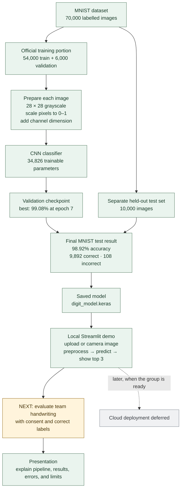

# Project overview: from MNIST to the demo

Workflow, measured results, and the next evaluation task.

## What the results do and do not say

The **98.92%** score is on the standard, held-out MNIST test set. It is not a measurement of accuracy on our own handwriting or every phone photo. Of the 108 MNIST errors, **25 still had a top softmax score of at least 90%**; treat those scores as model scores, not calibrated certainty.

## Read the details

- [Training report, graphs, evaluation and cited research review](MODEL_EVALUATION.md)
- [Build journal: what changed and why](DEVELOPMENT_LOG.md)
- [Model architecture and data flow](MODEL_ARCHITECTURE.md)
- [Real-handwriting evaluation plan](HANDWRITING_EVALUATION.md)
- [Numbered, commented build scripts](.)

**Current stage:** benchmark and local demo are ready; real team handwriting evaluation remains. Cloud deployment is deferred.
