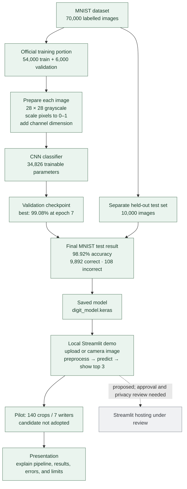

# Project overview: from MNIST to the demo

Workflow, measured results, the completed handwriting pilot, and the proposed hosting step.

## What the results do and do not say

The **98.92%** score is on the standard, held-out MNIST test set. It is not a measurement of accuracy on our own handwriting or every phone photo. Of the 108 MNIST errors, **25 still had a top softmax score of at least 90%**; treat those scores as model scores, not calibrated certainty.

The later seven-writer pilot yielded 60% on writer 6 and 50% on writer 7 for both the original and the fine-tuned candidate. These are small exploratory checks, not a general accuracy estimate. The original guided model remains the app model. No cloud deployment has been verified.

## Read the details

- [Training report, graphs, evaluation and cited research review](MODEL_EVALUATION.md)
- [Build journal: what changed and why](DEVELOPMENT_LOG.md)
- [Model architecture and data flow](MODEL_ARCHITECTURE.md)
- [Real-handwriting evaluation plan](HANDWRITING_EVALUATION.md)
- [Model and experiment record](../docs/MODEL_AND_EXPERIMENTS.md)
- [Project audit and Git status](../docs/PROJECT_AUDIT.md)
- [Numbered, commented build scripts](.)

**Current stage (8 October 2026):** guided MNIST benchmark and local demo exist; a seven-writer handwriting pilot is recorded; an independent new-writer check, Git working clone, and cloud deployment remain open.
