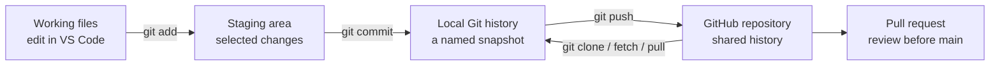

# Git and GitHub for this project

**Updated:** 8 October 2026. This guide explains the terms, the actual repository state, and the safest next workflow for a group that is new to Git.

## 1. The simple distinction

**Git** is the version-control program. It records selected file snapshots called **commits** and lets you compare or restore earlier versions. A Git repository can live entirely on your computer. **GitHub** hosts a Git repository online and adds collaboration tools such as issues and pull requests. A folder of Python files is not automatically a Git repository just because similar files exist on GitHub.



| Term | Meaning in this project |
| --- | --- |
| Repository | The project plus its Git history. The existing GitHub repo is private. |
| `main` | The shared branch that currently contains the versioned app and model. |
| Branch | A separate line of work for a change, such as updating documentation, without changing `main` immediately. |
| Commit | A recorded snapshot with an explanation of what changed. |
| `origin` | The common local nickname for the GitHub repository after it is cloned. |
| Clone | Download the repository and its history into a new local working folder. |
| Pull request | A review page showing branch changes before they are merged into `main`. |
| `.gitignore` | Rules for keeping **untracked** local files out of Git, such as virtual environments and personal handwriting samples. |

Official explanations: [Pro Git: version control](https://git-scm.com/book/en/v2/Getting-Started-About-Version-Control.html), [Git staging and commits](https://git-scm.com/book/en/v2/Appendix-C%3A-Git-Commands-Basic-Snapshotting), [GitHub remote changes](https://docs.github.com/en/get-started/using-git/getting-changes-from-a-remote-repository), and [GitHub pull-request flow](https://docs.github.com/en/get-started/using-github/hello-world).

## 2. What exists today

- The private repository is [Shorya-Raj/cc-ese-handwritten-digit-recognition](https://github.com/Shorya-Raj/cc-ese-handwritten-digit-recognition). At the audit, `main` pointed to commit `ecd3c14e28cb33875d8c6cc5eca138d15dc1dd98` and had three commits. It includes the guided app, model, evaluation, README, contributor guide and an open issue for real-handwriting evaluation.
- The Desktop `Handwritten Digit Recognition` folder and the original `CC ESE 2` workspace both contain project files, but `git rev-parse --show-toplevel` reports **neither is a Git repository**. Neither folder can `git pull` or show local project commit history as it stands.
- The Desktop guided model exactly matches the model in GitHub. Many text files are distinct copies due to repository layout and wording changes. Their contents must be compared, not blindly overwritten.
- The GitHub `.gitignore` excludes `digit_recognition/artifacts/real_handwriting/`. The Desktop `.gitignore` does not exclude its corresponding `guided_build/artifacts/real_handwriting/` folder, where one saved original/prepared image pair and a CSV currently exist.
- The GitHub repository is **private**. A future public Streamlit app, if chosen, would have its own access and data-flow implications; repository privacy is a separate setting.

## 3. Is Git necessary here?

Git is **strongly useful** for this team project because several people may edit code and documents, the trained model/results need an identifiable version, and Streamlit Community Cloud deploys from a GitHub repository. The project already has a GitHub repository, so the correct next local setup is to **clone that existing repository**, not create a second one or run `git init` in an old copy. There is no need to adopt advanced Git features, Git LFS, submodules, or a complex branching strategy for this small project.

The current execution environment could read GitHub through the connected GitHub app but a normal `git ls-remote` could not reach `github.com:443`; an elevated attempt did not return and was stopped. This is an access limitation of the local Git command in this session. It does not mean the repository is missing. A browser sign-in does not automatically configure Git command-line authentication. Until cloning works, repository documentation can be prepared locally and added to a review branch through the GitHub connector. Do **not** create an unrelated local history to work around failed cloning.

## 4. Safe first clone in VS Code, when Git CLI access works

Choose a new, empty destination folder. From its parent directory in the VS Code PowerShell terminal:

```powershell
git clone https://github.com/Shorya-Raj/cc-ese-handwritten-digit-recognition.git
cd cc-ese-handwritten-digit-recognition
git status
git remote -v
git log --oneline -5
```

This new folder becomes the Git working copy. In VS Code, use **File → Open Folder** on it. Keep the old Desktop folder untouched until its unique files have been compared and any intended changes have been moved carefully. GitHub access to a private repository may require your GitHub sign-in through Git Credential Manager or VS Code. Do not paste tokens into code or commit them.

If the first command says the destination already exists, inspect that folder rather than forcing the clone over it. If it cannot connect or authenticate, fix network/credential access before doing anything that changes Git history.

## 5. One small group change, step by step

```powershell
git switch main
git pull --ff-only origin main
git switch -c docs/experiment-record

# Edit the intended files in VS Code, then inspect:
git status --short
git diff

# Stage only files you inspected:
git add README.md docs/PROJECT_AUDIT.md docs/MODEL_AND_EXPERIMENTS.md
git diff --cached --name-only
git diff --cached
git commit -m "Document model and project audit"
git push -u origin docs/experiment-record
```

Open a pull request on GitHub from the branch into `main`, review the file list and wording, and ask a teammate to review before merging. A focused branch makes it easier to see what changed. `git pull --ff-only` prevents Git from creating an unexpected merge commit while updating `main`.

For a later change, start a **new** branch from the updated `main`. Do not keep accumulating unrelated training, app, and documentation work on one branch.

## 6. Checks before any push

1. Run `git status --short` and read every listed path.
2. Stage specific files. Avoid `git add .` until you understand everything in the folder.
3. Run `git diff --cached --name-only` and `git diff --cached` to see the exact staged change.
4. Ensure no personal handwriting original/crop, contributor name, key, token, `.env`, `.venv`, or local cache is staged.
5. If a file is ignored, `git check-ignore -v path/to/file` tells you which rule applies.
6. If a sensitive file is already tracked, adding it to `.gitignore` **does not remove it**. Stop and handle the tracked file and history carefully; [Git's official gitignore documentation](https://git-scm.com/docs/gitignore/) explicitly says ignore rules affect intentionally untracked files.
7. Record changes to the model, preprocessing, dataset split and metrics together. A result without its code/model version is easy to misinterpret.

GitHub currently has an appropriate ignore rule for its own `digit_recognition/artifacts/real_handwriting/` path. The Desktop folder should receive a matching `guided_build/artifacts/real_handwriting/` rule before anyone turns that old folder into a Git repository or stages it elsewhere. The safest route is still a fresh clone of the existing remote, where the correct repository rule is already present.

## 7. What we will and will not version

| Include in Git | Keep local or decide separately |
| --- | --- |
| Python source, requirements, README, instructions, architecture and experiment records | Virtual environment, caches and editor-specific files |
| The selected small guided model and reproducible MNIST metric files already in the private repo | Original contributor handwriting photos and app-saved samples |
| Plot images needed to understand documented results | Credentials, secret files and personal absolute paths |
| Reviewable documentation changes | Unproven replacement models or huge duplicate experiment artifacts without an agreed purpose |

The repository already versions one small `.keras` model file. Git can store it, though Git cannot display a useful line-by-line diff of model weights. If future experiments produce many large models, decide on a separate artifact strategy then; no additional tool is necessary now.

## 8. When hosting is chosen

Streamlit Community Cloud can deploy an app from a GitHub repository/branch/entry file. That makes keeping the repository organized and current important. Deployment itself is a separate task: verify the source branch, selected entry file, package installation, model path, privacy behavior and live URL. A successful `git push` or pull request is evidence of a code update, **not** evidence that the cloud app works.

