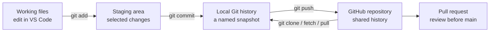

# Git and GitHub for this project

**Updated:** 9 October 2026. This guide explains the terms, the current repository state, and the next workflow for a group that is new to Git.

## 1. The simple distinction

**Git** is the version-control program. It records selected file snapshots called **commits** and lets you compare or restore earlier versions. A Git repository can live entirely on your computer. **GitHub** hosts a Git repository online and adds collaboration tools such as issues and pull requests. A folder of Python files is not automatically a Git repository just because similar files exist on GitHub.



| Term | Meaning in this project |
| --- | --- |
| Repository | The project plus its Git history. The existing GitHub repo is private. |
| `main` | The shared branch that currently contains the versioned app and model. |
| Branch | A separate line of work for a change, such as updating documentation, without changing `main` immediately. |
| Commit | A recorded snapshot with an explanation of what changed. |
| `origin` | The common local nickname for the GitHub repository after it is cloned. |
| Clone | Download the repository and its history into a new local working folder. |
| Pull request | A review page showing branch changes before they are merged into `main`. |
| `.gitignore` | Rules for keeping **untracked** local files out of Git, such as virtual environments and personal handwriting samples. |

Official explanations: [Pro Git: version control](https://git-scm.com/book/en/v2/Getting-Started-About-Version-Control.html), [Git staging and commits](https://git-scm.com/book/en/v2/Appendix-C%3A-Git-Commands-Basic-Snapshotting), [GitHub remote changes](https://docs.github.com/en/get-started/using-git/getting-changes-from-a-remote-repository), and [GitHub pull-request flow](https://docs.github.com/en/get-started/using-github/hello-world).

## 2. What exists today

- The private repository is [Shorya-Raj/cc-ese-handwritten-digit-recognition](https://github.com/Shorya-Raj/cc-ese-handwritten-digit-recognition). On 9 October, GitHub `main` and the local clone both pointed to `c1396be724dca6485128cbdc44cffe0ae6ccba88`. Pull request #2 had been merged. The repository had four commits and 37 tracked files, including the guided app, its model, evaluation, README and contributor guide.
- On this computer, `CC ESE 2/cc-ese-handwritten-digit-recognition/` is a Git clone connected to that repository. The parent `CC ESE 2` folder and the separate Desktop guided project are not Git repositories. Open the **nested clone** in VS Code for team app work and Git commands.
- The Desktop guided scripts and repository scripts have matching model, evaluation, preprocessing and app logic. Repository paths, report wording and the report output filename differ. The Desktop guided model matches the repository model. The parent workspace's earlier baseline model and fine-tuned candidate are intentionally different artifacts. Compare changes before transferring them into the clone.
- The GitHub `.gitignore` excludes `digit_recognition/artifacts/real_handwriting/`. The Desktop `.gitignore` originally missed its corresponding `guided_build/artifacts/real_handwriting/` folder, where one saved original/prepared image pair and a CSV currently exist. The protective rule was added on 8 October.
- The GitHub repository is **private**. A future public Streamlit app, if chosen, would have its own access and data-flow implications; repository privacy is a separate setting.

## 3. Is Git necessary here?

Git is **strongly useful** for this team project because several people may edit code and documents, the trained model/results need an identifiable version, and Streamlit Community Cloud deploys from a GitHub repository. The project already has a GitHub repository and a local clone on this computer. Use that clone for team work, or clone the same repository on another computer. Do not start a second Git history inside an older copy. There is no need to adopt Git LFS, submodules, or a complex branching strategy for this small project.

The existing local clone has the correct `origin` URL and matches GitHub `main` as of 9 October. This verifies its repository identity; it does not by itself verify that this computer can push a new branch. If pushing asks for authentication, sign in through Git Credential Manager or VS Code. Do not paste tokens into code or commit them.

## 4. Open the working clone in VS Code

From the `CC ESE 2` parent folder in PowerShell:

```powershell
cd .\cc-ese-handwritten-digit-recognition
git status
git remote -v
git log --oneline -5
```

In VS Code, use **File → Open Folder** on `cc-ese-handwritten-digit-recognition`, not its parent folder, when editing the team app. The older workspace holds a separate baseline and handwriting pilot; do not copy either model over the guided model in the clone.

On another computer, clone the same private repository into an empty destination using `git clone https://github.com/Shorya-Raj/cc-ese-handwritten-digit-recognition.git`. GitHub access may require your account's permission to the private repository.

## 5. One small group change, step by step

```powershell
git switch main
git pull --ff-only origin main
git switch -c docs/experiment-record

# Edit the intended files in VS Code, then inspect:
git status --short
git diff

# Stage only files you inspected:
git add README.md docs/PROJECT_AUDIT.md docs/MODEL_AND_EXPERIMENTS.md
git diff --cached --name-only
git diff --cached
git commit -m "Document model and project audit"
git push -u origin docs/experiment-record
```

Open a pull request on GitHub from the branch into `main`, review the file list and wording, and ask a teammate to review before merging. A focused branch makes it easier to see what changed. `git pull --ff-only` prevents Git from creating an unexpected merge commit while updating `main`.

For a later change, start a **new** branch from the updated `main`. Do not keep accumulating unrelated training, app, and documentation work on one branch.

## 6. Checks before any push

1. Run `git status --short` and read every listed path.
2. Stage specific files. Avoid `git add .` until you understand everything in the folder.
3. Run `git diff --cached --name-only` and `git diff --cached` to see the exact staged change.
4. Ensure no personal handwriting original/crop, contributor name, key, token, `.env`, `.venv`, or local cache is staged.
5. If a file is ignored, `git check-ignore -v path/to/file` tells you which rule applies.
6. If a sensitive file is already tracked, adding it to `.gitignore` **does not remove it**. Stop and handle the tracked file and history carefully; [Git's official gitignore documentation](https://git-scm.com/docs/gitignore/) explicitly says ignore rules affect intentionally untracked files.
7. Record changes to the model, preprocessing, dataset split and metrics together. A result without its code/model version is easy to misinterpret.

GitHub currently has an appropriate ignore rule for its own `digit_recognition/artifacts/real_handwriting/` path. A matching Desktop rule for `guided_build/artifacts/real_handwriting/` was added on 8 October. Use the existing clone or a new clone of this repository so the repository rule and history are present.

## 7. What we will and will not version

| Include in Git | Keep local or decide separately |
| --- | --- |
| Python source, requirements, README, instructions, architecture and experiment records | Virtual environment, caches and editor-specific files |
| The selected small guided model and reproducible MNIST metric files already in the private repo | Original contributor handwriting photos and app-saved samples |
| Plot images needed to understand documented results | Credentials, secret files and personal absolute paths |
| Reviewable documentation changes | Unproven replacement models or huge duplicate experiment artifacts without an agreed purpose |

The repository already versions one small `.keras` model file. Git can store it, though Git cannot display a useful line-by-line diff of model weights. If future experiments produce many large models, decide on a separate artifact strategy then; no additional tool is necessary now.

## 8. Current hybrid demo

The current demo is a local Streamlit interface with inference in AWS Lambda. The Lambda ZIP is built from Linux-compatible Python wheels with `cloud/build_zip.py`, and the local interface reads its AWS URL and token from the ignored `.streamlit/secrets.toml`. Streamlit preprocessing sends only the prepared 28 × 28 pixel array; the app's labelled-sample button continues to save the original and prepared images on the local computer. The temporary endpoint was deployed and checked on 12 October 2026. Follow the root README's demo and teardown steps. The token, URL configuration, and deployment ZIP are ignored; edits left only in the parent workspace or unpushed local clone will not appear in GitHub.

