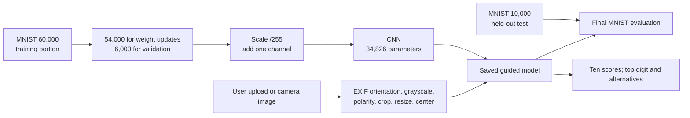

# Model, data, and experiment record

**Updated:** 8 October 2026  
**Purpose:** Explain what was built, exactly which results were measured, which model the app uses, and what the current evidence cannot establish.

## 1. Status at a glance

| Item | Current state |
| --- | --- |
| Task | Classify one handwritten digit as an integer from 0 to 9. |
| App model | The guided MNIST CNN saved as `digit_model.keras` beside the numbered app scripts. This remains the active app artifact. |
| Input | One image, prepared into a `(1, 28, 28, 1)` float32 batch with values in the range 0–1. |
| MNIST benchmark | 9,892 correct of 10,000 held-out test images: **98.92%**. |
| Real handwriting evidence | A small, exploratory 140-crop, seven-writer fine-tuning study. A separate one-page Paint demonstration was 10/10, but it is not an accuracy benchmark. |
| Fine-tuned model | Saved separately as an experimental candidate. It was **not adopted**, because the two writer checks did not improve. |
| Cloud model | None. Hosting is proposed; no cloud inference endpoint was verified. |

## 2. Data and model pipeline



MNIST supplies 60,000 images in its official training portion and 10,000 in its separate test portion. The training script passes the 60,000 training images to Keras with `validation_split=0.10`, so 54,000 are used for gradient updates and 6,000 for validation. The validation split is taken from the end of the supplied training arrays before Keras shuffles the training portion; the script does not claim a new randomized or writer-stratified validation set. The 10,000 official test images are not passed to `model.fit`.

Training images are 28 × 28 grayscale with pixel values 0–255. They are converted to `float32`, divided by 255 and given a final one-channel dimension. Uploaded photos require additional preparation because they are not already centered MNIST pictures. The upload function corrects EXIF orientation, composites transparency onto white, makes grayscale, applies contrast, determines whether to invert dark-on-light writing, reduces faint background noise, crops visible ink, fits it within a 20 × 20 box on a 28 × 28 canvas and shifts the ink center. The app shows this prepared image beside the original, which helps diagnose a wrong crop or inversion. It does not prove the preparation is reliable for all lighting and paper conditions.

## 3. CNN architecture and training choices

| Stage | Output shape | Learned parameters | Role |
| --- | --- | ---: | --- |
| Input | 28 × 28 × 1 | 0 | One prepared grayscale digit. |
| Conv2D, 32 filters, 3 × 3, ReLU | 26 × 26 × 32 | 320 | Learn local stroke patterns. |
| Max pooling, 2 × 2 | 13 × 13 × 32 | 0 | Reduce spatial size. |
| Conv2D, 64 filters, 3 × 3, ReLU | 11 × 11 × 64 | 18,496 | Combine local features. |
| Max pooling, 2 × 2 | 5 × 5 × 64 | 0 | Reduce spatial size again. |
| Flatten | 1,600 values | 0 | Convert feature maps to a vector. |
| Dropout, 0.25 | 1,600 values | 0 | Drop some training activations; inactive during inference. |
| Dense, 10 outputs, softmax | 10 scores | 16,010 | Produce one score per digit. |
| **Total** | | **34,826** | |

The guided training run used seed 42, Adam with learning rate 0.001, sparse categorical cross-entropy, batches of 128, a maximum of eight epochs, and early stopping on validation loss with patience two and `restore_best_weights=True`. All eight epochs ran. Validation loss was lowest at epoch 7, so the saved weights correspond to the best observed validation-loss checkpoint rather than an assumed eighth-epoch improvement. The saved training history records the per-epoch accuracy and loss curves. A seed improves repeatability but does not guarantee bit-identical training across hardware and library versions.

The project pins Streamlit 1.65.0, TensorFlow 2.21.0, Pillow 12.3.0, NumPy 2.5.3, and Matplotlib 3.11.2 in `requirements.txt`. These are the documented project package versions; a future cloud build still needs its own compatibility check.

## 4. Saved MNIST evaluation

| Metric | Saved result |
| --- | ---: |
| Test examples | 10,000 |
| Correct | 9,892 |
| Wrong | 108 |
| Accuracy | 98.92% |
| Test loss | 0.03274034 |
| Macro F1 | 0.9891 |
| Best validation accuracy during training | 99.08% at epoch 7 |
| Wrong answers with a largest softmax score ≥ 90% | 25 |

Per-digit recall (the share of actual examples of each digit classified correctly) is saved in `test_results.json`:

| Digit | Recall | Digit | Recall |
| ---: | ---: | ---: | ---: |
| 0 | 99.80% | 5 | 99.10% |
| 1 | 99.65% | 6 | 98.02% |
| 2 | 99.03% | 7 | 98.54% |
| 3 | 98.81% | 8 | 98.77% |
| 4 | 99.80% | 9 | 97.62% |

The largest softmax value is displayed as a **model score**, not a calibrated probability of being correct. Twenty-five wrong MNIST predictions had a top score at or above 90%, which is a concrete reason not to promise certainty from the interface.

The GitHub repository and Desktop guided folder contain matching guided model bytes and matching key saved MNIST results. The earlier `CC ESE 2/artifacts/digit_model.keras` is a separate baseline file; its own `metrics.json` also reports 98.92% MNIST test accuracy, but its SHA-256 differs. Keep the two training runs distinct.

## 5. Real-handwriting collection and fine-tuning pilot

The student supplied two photographed pages of digit examples. Each page had seven contributor columns with one digit 0–9 per column. The experiment used fixed, manually measured crop centers, producing **7 writers × 2 rounds × 10 digits = 140 labelled crops**. It used the app's `prepare_image` and `to_model_batch` functions on each crop. The source photos and individual processed images were held in memory during this run; the saved output folder contains metrics, predictions, plots and the candidate model, not the source photos or crop images.

| Split | Writers | Samples | Role |
| --- | --- | ---: | --- |
| Fine-tuning | 1–5 | 100 handwriting crops | Update only the final dense classifier layer. |
| MNIST replay | MNIST training portion | 200 (20 per digit) | Mix with handwriting during fine-tuning. |
| Validation | 6 | 20 handwriting crops | Monitor training and choose the checkpoint. |
| Held-out pilot check | 7 | 20 handwriting crops | Inspect a writer not used for gradient updates. |

The experiment trained a copy of the guided model with its convolutional layers frozen. It used Adam at 0.00002, batches of 16, up to 40 epochs, mild training-only random rotation/translation, early stopping on writer-6 validation loss, and a learning-rate reduction callback. Forty epochs were completed. The official MNIST test images were measured after training, not mixed into fine-tuning.

| Evaluation set | Guided original | Fine-tuned candidate | Count |
| --- | ---: | ---: | ---: |
| Writer 6 validation | 60% | 60% | 20 |
| Writer 7 held-out pilot | 50% | 50% | 20 |
| MNIST official test | 98.92% | 98.98% | 10,000 |

**Interpretation:** the candidate did not improve either writer check. Its six-hundredths of a percentage point MNIST change does not establish a meaningful real-handwriting benefit. Writer 7 was held out from gradient updates, but predictions from an earlier sheet had already been inspected before this pilot. It is therefore a writer-separated exploratory check, **not** an untouched final benchmark. The group should reserve newly collected writers if a later model comparison is needed. The guided original stays in the app.

The experiment's reported base-model SHA-256 is `8663ea03af57702a9ea388da72c43eb7ba176aaf9f7562c413e1371fb237ab65`. The candidate file is separate (`handwriting_finetuned_model.keras`, SHA-256 `0bfb5d3185642ce222b73e10210eb91a1149a367b3a7901228ef87546d2f445d`). The pilot script and results live in the original workspace, not in the examined GitHub `main` tree as of this audit.

## 6. Other demonstration evidence

- An earlier Paint image with the digits 0–9 was run through the existing model and all ten individual predictions were correct. It is one selected demonstration image, not a statistically meaningful accuracy measure.
- The Desktop app has a local labelled-example save feature and one saved example in its `real_handwriting` folder. That folder is personal evaluation material, not part of the published benchmark and not in the examined GitHub tree.
- The app also accepts a camera image. The published MNIST result does not measure arbitrary phone photos, shadows, page segmentation, multiple digits or every writer's style.

## 7. Artifacts and provenance

| Artifact | Meaning | Handling |
| --- | --- | --- |
| `digit_model.keras` | Guided model loaded by the local app | Versioned in the private GitHub repository; preserve its identity when presenting results. |
| `training_history.json` | Eight per-epoch train/validation metrics | Use for learning curves; not a final test result. |
| `test_results.json`, `confusion_matrix.csv` | MNIST test metrics and class confusions | Source for the 98.92% statement. |
| `MODEL_EVALUATION.md` / `TRAINING_REPORT.md` and plot PNGs | Human-readable run explanation and charts | Verify they refer to the same saved run before presenting. |
| `fine_tune_handwriting.py` and `artifacts/handwriting_finetune_2026-10-06/` | Separate seven-writer pilot with metrics and plots | Keep separate from the app model; sanitize personal absolute paths before sharing metrics publicly. |
| `real_handwriting/` saved app samples | Original and prepared user images plus labels | Keep local and out of GitHub unless contributors explicitly agree to another handling plan. |

The pilot's `metrics.json` records an absolute local base-model path. That path is machine-specific metadata and should be removed or replaced with a relative path before the metrics file is shared in a public repository. The raw contributor photos are not needed for the demo or for a code-only GitHub update.

## 8. Reproducing or extending results safely

The existing saved model and results are enough to run the current app and explain the training run. Running the training script again **overwrites** the saved model and can change metrics. Before a new experiment, copy the current artifacts into a clearly named run folder, record the exact code version, package versions, dataset/split, seed, settings and date, then evaluate the new candidate separately. Do not train on the official MNIST test set or on a writer intended for final comparison.

Use the numbered scripts in order only when a rerun is intentional. The local app command from the Desktop project root is:

```powershell
.\.venv\Scripts\python.exe -m streamlit run .\guided_build\step_08_app.py
```

In the GitHub repository layout, the corresponding path is `digit_recognition/step_08_app.py`. The remote README lists the full clone/install/run steps. Raw handwriting photos are required to reproduce the pilot crop experiment, and their use needs contributor consent; the metric files alone can be reviewed without those photos.

## 9. Appropriate next evaluation, if the team later chooses it

Reserve a new group of writers who were not used in the seven-writer pilot. Record the input type (paper photo, camera, Paint drawing), digit, prediction, and whether the 28 × 28 prepared image preserved the writing. Report counts by writer/input type and inspect failures before changing preprocessing or retraining. With a small volunteer sample, present it as an exploratory check and avoid claims about population-wide real-world accuracy.

