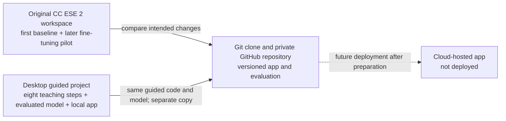

# Project audit and work required

**Initial audit:** 8 October 2026

**Repository and folder status updated:** 9 October 2026
**Scope:** Existing handwritten digit recognizer, its saved evidence, local folders, and the GitHub repository. No model training or cloud deployment was performed for this audit.

**Current visibility note (14 October 2026):** GitHub reports this repository as public. Earlier sections preserve their dated records and previously reported visibility; this update does not determine when the repository became public.

**Later status (12 October 2026):** This is a historical 8–9 October audit. The team subsequently deployed a temporary AWS Lambda inference endpoint for the local Streamlit app. Streamlit itself is still running on the presenting laptop, not on Streamlit Community Cloud. See the [README](../README.md) and [dated work log](WORK_LOG.md) for the live-check evidence and teardown plan. The older deployment-pending statements below describe the state at audit time.

## 1. The project in one diagram

The folders are **not automatically synchronized**. The parent `CC ESE 2` folder and separate Desktop guided folder have no `.git` directory. A Git clone now exists at `CC ESE 2/cc-ese-handwritten-digit-recognition/` and is the team's working copy for the current app. Its `origin` points to the private GitHub repository. The older baseline and fine-tuning experiment remain reference material; compare their files before transferring an intended change into the clone.

## 2. Verified inventory

| Location | Contains | Verified state |
| --- | --- | --- |
| Original `CC ESE 2` workspace | `train_model.py`, `app.py`, original `artifacts/digit_model.keras`, `PROJECT_PLAN.md`, guided source copies, `fine_tune_handwriting.py`, fine-tuning results, course report | No local Git repository. The original baseline model is a distinct file from the guided model. Several plan statements predate the handwriting pilot. |
| Desktop `Handwritten Digit Recognition` | `guided_build/step_01_data.py` through `step_08_app.py`, `guided_build/artifacts/` with model, metrics and plots, `TRAINING_REPORT.md`, journal and walkthrough, `.venv` | Working guided project from the earlier build. One local labelled sample is present under `guided_build/artifacts/real_handwriting/`. No local Git repository. Its `.gitignore` originally missed that folder; the protective rule was added on 8 October. |
| Git clone and GitHub `Shorya-Raj/cc-ese-handwritten-digit-recognition` | On 9 October, local and GitHub `main` both pointed to `c1396be724dca6485128cbdc44cffe0ae6ccba88`; 4 commits and 37 tracked files. The clone is nested in `CC ESE 2/`. | This is the versioned team source for the guided model, app, metrics, plots and current documentation. The handwriting sample folder is ignored. The original workspace's separate baseline and fine-tuning candidate are not loaded by the app. |
| Streamlit Community Cloud | Proposed hosting destination | No deployed app or public URL was verified. |

**Model identity check:** The Desktop guided model and GitHub's tracked `digit_recognition/artifacts/digit_model.keras` have the same Git blob ID, `b5d125bbe90725b2f98b8d0583ba42b3e1743629`. The Desktop model's SHA-256 is `8663ea03af57702a9ea388da72c43eb7ba176aaf9f7562c413e1371fb237ab65` (452,769 bytes). The original workspace baseline has a different SHA-256, `af1722e8762c599709eae90e4c5ecd245bb6e1f712d8c4f315bd1bcec9f91079` (452,763 bytes). Same reported MNIST accuracy does not mean the files are identical.

**Results check:** The GitHub and Desktop saved test summaries agree on 10,000 MNIST test examples, 98.92% accuracy, 108 errors, eight training epochs and a best validation accuracy of 99.08%. The text files differ byte-for-byte because the repository was reorganized and wording/paths changed; no automatic equivalence of all source files is assumed.

## 3. What the code currently does

1. `step_01_data.py` loads MNIST and inspects the images and labels.
2. `step_02_prepare_images.py` scales pixel values from 0–255 to 0–1 and adds a grayscale channel.
3. `step_03_model.py` builds a 34,826-parameter convolutional neural network for classes 0–9.
4. `step_04_train.py` trains on the MNIST training portion, reserves 10% for validation, and saves the model and training history.
5. `step_05_evaluate.py` evaluates the saved model on the separate MNIST test set and records mistakes and metrics.
6. `step_06_report.py` generates plots and the detailed training/evaluation report from saved outputs.
7. `step_07_prepare_upload.py` turns a user image into a centered 28 × 28 grayscale model input.
8. `step_08_app.py` runs the local Streamlit upload/camera interface, shows the processed input and top predictions, and offers a button to save labelled samples locally.

The application loads the guided model artifact. The fine-tuned candidate is separate and is **not** the app model. See [MODEL_AND_EXPERIMENTS.md](MODEL_AND_EXPERIMENTS.md) for exact settings and evidence.

## 4. Status and remaining work

| Status | Work | Evidence or next action |
| --- | --- | --- |
| Done | Record the seven-writer pilot accurately | `MODEL_AND_EXPERIMENTS.md` and the README distinguish MNIST results, writer checks and the inactive fine-tuned candidate. |
| Done | Establish a local Git working copy | The nested clone has the correct `origin` and matched GitHub `main` at `c1396be` on 9 October. Pull request #2 was merged. |
| Ongoing | Keep team status aligned | Update the open handwriting issue to reflect the completed pilot and any remaining evaluation work. Make app and documentation changes in the clone, then push through the team's Git workflow. |
| Ongoing | Keep personal samples out of Git | Both the Desktop and repository ignore rules cover their respective handwriting sample folders. Review staged files because ignore rules do not remove files already tracked. |
| Pending | Prepare a clean deployment package if Streamlit is chosen | A public app should not expose the current sample-saving feature. Check dependency compatibility, model path, privacy notice, build logs and fresh-browser behavior after a host is chosen. |
| Pending | Finish course evidence | Confirm date and platform with the instructor; prepare CO3 comparison, CO4 risk/data-flow explanation, literature citations, running-example rehearsal and viva. |

## 5. Work that is not justified now

- **Retraining the model or increasing image resolution:** the current task is documentation and audit; the seven-writer fine-tune did not improve its writer-separated checks. A new experiment needs a clear error pattern and a reserved evaluation set.
- **Replacing the guided model with the fine-tuned copy:** the candidate matched, rather than improved, the two writer checks (60% and 50%).
- **Creating another GitHub repository:** the private project repository already exists and has history, code and documentation.
- **Running `git init` inside either existing local folder:** doing so would start a separate history unrelated to the existing GitHub `main`. A normal clone is the correct way to get that history locally.
- **Publishing raw handwriting sheets or saved app samples:** these are unnecessary for a public code repository and would create a privacy problem.
- **Assuming a cloud deployment is complete because an app and README exist:** the hosted URL, startup, privacy behavior and resource fit have not been verified.
- **Adding a VM, database, CI pipeline, user accounts, or paid cloud service solely for appearance:** none is required by the written presentation rubric reviewed so far. Add one only for a real requirement or an agreed experiment.

## 6. Decisions and external facts still open

1. Instructor confirmation of the presentation date: student update says by **18 October**; the evaluation PDF labels **19 October 2026** tentative.
2. Whether Streamlit Community Cloud and a public app URL satisfy the instructor's current interpretation of “cloud-based application.” The reviewed PDFs name no mandatory provider.
3. Final image-data policy for a hosted app. The safest proposed public-demo behavior is prediction without intentional storage; the current local app still has a save button.
4. Whether the team's Git command-line authentication can push a new branch from the local clone. The clone's existence and matching commit do not prove push access.

## 7. Evidence and limits of this audit

- GitHub repository metadata, `main` tree, recent commits, issue #1, README and source files were read through the GitHub connector on 8 October 2026; GitHub `main` and pull request #2 were checked again on 9 October.
- Both original local folders were listed and inspected. Their top-level directories are not Git repositories. The nested clone's local status, remote URL and commit were checked on 9 October.
- File identities were checked with Git blob IDs and SHA-256. GitHub and Desktop summary values were compared directly.
- Existing saved metrics and source code were inspected. The guided scripts in the original workspace and clone have matching model, evaluation, preprocessing and app logic. Repository paths, report wording and the report output filename differ. This audit did not retrain, re-evaluate the model, open the app, or test a cloud deployment.
- For course alignment, see `STREAMLIT_CLOUD_COURSE_ALIGNMENT_REPORT.html` in the original workspace. Instructor approval and presentation grading remain external decisions.

## Current verified snapshot — reconciled 14 October 2026

> This snapshot supersedes the current-status interpretation of the 8–9 October audit below. The older sections remain intact as historical evidence and are not rewritten as if those facts were current then.

| Area | Latest evidence | Current interpretation |
| --- | --- | --- |
| Git/GitHub | Local `main` and `origin/main` matched at `87cea5b6e59314d047760479149d90a3d42feb92`; working tree was clean before this documentation update. PR #4 and PR #5 are included. GitHub reported the repository public on 14 October. | This nested clone is the team's versioned source. Parent-workspace and Desktop folders remain separate copies. Review every staged file for public release before pushing. |
| Model | Guided CNN has 34,826 parameters and 98.92% accuracy on 10,000 held-out MNIST images. The separate seven-writer pilot did not improve either writer check: writer 6 remained 60%, writer 7 remained 50%. | The guided model remains active. MNIST accuracy is not real-world handwriting accuracy. |
| App/cloud path | Local Streamlit UI and Python preprocessing; prepared 28×28 grayscale pixels go to optional AWS Lambda inference. Local Keras inference remains fallback. On 13 October, the live check recorded digit 5, 401 without token, 400 for malformed input, and AWS/local score difference no greater than `1.19e-7` on the sample. | The hybrid demo passed the recorded end-to-end sample check on 13 October. This documentation update did not recheck current availability. |
| AWS safeguards/limits | At the 13 October check, Lambda was Active/Successful in `ap-southeast-2`; Function URL used `AuthType NONE` with a bearer-token check in the handler; deployment bucket blocked public access and used SSE-S3; CloudWatch retention was three days. | An unauthorized request can invoke the function before receiving 401. Recheck before a demo and remove temporary resources after course use. |
| Handwriting samples | The saved pilot report covers 140 crops from seven writers. | A new large classmate collection and further training are not evidenced in the current log. Treat as pending until samples, consent, handling, and results are recorded. |
| Course delivery | Several 12-slide deck variants, a four-speaker plan, and four speaker guides were created in the parent workspace on 14 October. The plan names `Handwritten_Digit_Cloud_12_Slides_Updated.pptx`, while newer exports exist. | Select one final deck and align the guides; actual speaker agreement, rehearsal, rubric/CO/PO review, and instructor guidance remain to be verified. These candidate presentation files are not in the GitHub repository. |

The cloud state above was **last verified 13 October**, not on this audit-update date. See [WORK_LOG.md](WORK_LOG.md) for detailed deployment records and [LOG_INDEX.md](LOG_INDEX.md) for the complete log inventory. The older sections below intentionally retain their point-in-time status.
