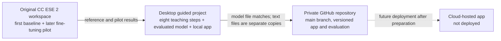

# Project audit and work required

**Date:** 8 October 2026  
**Scope:** Existing handwritten digit recognizer, its saved evidence, local folders, and the private GitHub repository. This is a documentation and repository audit. No model training or cloud deployment was performed for this audit.

## 1. The project in one diagram

The folders are **not automatically synchronized**. The two local folders have no `.git` directory. The GitHub repository has its own history and files. Treat each as a separate location until a proper Git clone and comparison establishes one working copy.

## 2. Verified inventory

| Location | Contains | Verified state |
| --- | --- | --- |
| Original `CC ESE 2` workspace | `train_model.py`, `app.py`, original `artifacts/digit_model.keras`, `PROJECT_PLAN.md`, guided source copies, `fine_tune_handwriting.py`, fine-tuning results, course report | No local Git repository. The original baseline model is a distinct file from the guided model. Several plan statements predate the handwriting pilot. |
| Desktop `Handwritten Digit Recognition` | `guided_build/step_01_data.py` through `step_08_app.py`, `guided_build/artifacts/` with model, metrics and plots, `TRAINING_REPORT.md`, journal and walkthrough, `.venv` | Working guided project from the earlier build. One local labelled sample is present under `guided_build/artifacts/real_handwriting/`. No local Git repository. Its `.gitignore` originally missed that folder; the protective rule was added on 8 October. |
| GitHub `Shorya-Raj/cc-ese-handwritten-digit-recognition` | Private repository; `main` at `ecd3c14e28cb33875d8c6cc5eca138d15dc1dd98` when audited; 3 commits; 33 tracked files; code under `digit_recognition/`; 1 open handwriting-evaluation issue | The repository has the guided model, app, metrics, plots, README and contributor docs. Its `.gitignore` excludes `digit_recognition/artifacts/real_handwriting/`. No raw handwriting images were present in the examined tree. Several documents still say handwriting evaluation and cloud work are deferred. |
| Streamlit Community Cloud | Proposed hosting destination | No deployed app or public URL was verified. |

**Model identity check:** The Desktop guided model and GitHub's tracked `digit_recognition/artifacts/digit_model.keras` have the same Git blob ID, `b5d125bbe90725b2f98b8d0583ba42b3e1743629`. The Desktop model's SHA-256 is `8663ea03af57702a9ea388da72c43eb7ba176aaf9f7562c413e1371fb237ab65` (452,769 bytes). The original workspace baseline has a different SHA-256, `af1722e8762c599709eae90e4c5ecd245bb6e1f712d8c4f315bd1bcec9f91079` (452,763 bytes). Same reported MNIST accuracy does not mean the files are identical.

**Results check:** The GitHub and Desktop saved test summaries agree on 10,000 MNIST test examples, 98.92% accuracy, 108 errors, eight training epochs and a best validation accuracy of 99.08%. The text files differ byte-for-byte because the repository was reorganized and wording/paths changed; no automatic equivalence of all source files is assumed.

## 3. What the code currently does

1. `step_01_data.py` loads MNIST and inspects the images and labels.
2. `step_02_prepare_images.py` scales pixel values from 0–255 to 0–1 and adds a grayscale channel.
3. `step_03_model.py` builds a 34,826-parameter convolutional neural network for classes 0–9.
4. `step_04_train.py` trains on the MNIST training portion, reserves 10% for validation, and saves the model and training history.
5. `step_05_evaluate.py` evaluates the saved model on the separate MNIST test set and records mistakes and metrics.
6. `step_06_report.py` generates plots and the detailed training/evaluation report from saved outputs.
7. `step_07_prepare_upload.py` turns a user image into a centered 28 × 28 grayscale model input.
8. `step_08_app.py` runs the local Streamlit upload/camera interface, shows the processed input and top predictions, and offers a button to save labelled samples locally.

The application loads the guided model artifact. The fine-tuned candidate is separate and is **not** the app model. See [MODEL_AND_EXPERIMENTS.md](MODEL_AND_EXPERIMENTS.md) for exact settings and evidence.

## 4. Work that is necessary now

| Priority | Work | Reason and completion evidence |
| --- | --- | --- |
| A | Keep one accurate model-and-experiments record | The repository's current docs predate the seven-writer pilot. Record dataset, split, settings, results, artifact identities and limits without claiming real-world accuracy. |
| A | Bring README, project overview and issue context up to date | Team members should see that the local demo exists, the pilot happened, the fine-tuned copy was not adopted, and cloud hosting remains proposed. |
| A | Establish a safe Git workflow | The private GitHub repository exists, but the local folders are unversioned copies. Clone the existing repository when Git network access is available; do not initialize either old folder and create unrelated history. Document branch/commit/PR steps. |
| A | Prevent accidental upload of personal samples | The Desktop ignore rule was added on 8 October; the GitHub ignore file already covered its corresponding repository path. Review staged files before every commit because ignore rules do not protect files that are already tracked. |
| B | Prepare a clean deployment package if Streamlit is chosen | A public app should not expose the current sample-saving feature. Check dependency compatibility, model path, privacy notice, build logs and fresh-browser behavior after a host is chosen. |
| B | Finish course evidence | Confirm date and platform with the instructor; prepare CO3 comparison, CO4 risk/data-flow explanation, literature citations, running-example rehearsal and viva. |

## 5. Work that is not justified now

- **Retraining the model or increasing image resolution:** the current task is documentation and audit; the seven-writer fine-tune did not improve its writer-separated checks. A new experiment needs a clear error pattern and a reserved evaluation set.
- **Replacing the guided model with the fine-tuned copy:** the candidate matched, rather than improved, the two writer checks (60% and 50%).
- **Creating another GitHub repository:** the private project repository already exists and has history, code and documentation.
- **Running `git init` inside either existing local folder:** doing so would start a separate history unrelated to the existing GitHub `main`. A normal clone is the correct way to get that history locally.
- **Publishing raw handwriting sheets or saved app samples:** these are unnecessary for a public code repository and would create a privacy problem.
- **Assuming a cloud deployment is complete because an app and README exist:** the hosted URL, startup, privacy behavior and resource fit have not been verified.
- **Adding a VM, database, CI pipeline, user accounts, or paid cloud service solely for appearance:** none is required by the written presentation rubric reviewed so far. Add one only for a real requirement or an agreed experiment.

## 6. Decisions and external facts still open

1. Instructor confirmation of the presentation date: student update says by **18 October**; the evaluation PDF labels **19 October 2026** tentative.
2. Whether Streamlit Community Cloud and a public app URL satisfy the instructor's current interpretation of “cloud-based application.” The reviewed PDFs name no mandatory provider.
3. Final image-data policy for a hosted app. The safest proposed public-demo behavior is prediction without intentional storage; the current local app still has a save button.
4. Which folder becomes the team's ongoing Git working copy after cloning the existing private repository. The remote repository is the only currently versioned source.
5. Git command-line authentication on this computer. The normal sandbox could not connect to GitHub. A later elevated, non-interactive check reached GitHub but reported `could not read Username` for the private repository. The GitHub connector can read and edit it; a local clone still needs the user's Git CLI authentication.

## 7. Evidence and limits of this audit

- GitHub repository metadata, `main` tree, recent commits, issue #1, README and source files were read through the GitHub connector on 8 October 2026.
- Both local folders were listed and inspected. `git rev-parse --show-toplevel` reported neither to be a Git repository.
- File identities were checked with Git blob IDs and SHA-256. GitHub and Desktop summary values were compared directly.
- Existing saved metrics and source code were inspected. This audit did not retrain, re-evaluate the model, open the app, or test a cloud deployment.
- For course alignment, see `STREAMLIT_CLOUD_COURSE_ALIGNMENT_REPORT.html` in the original workspace. Instructor approval and presentation grading remain external decisions.

