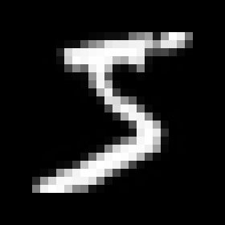

# Understand the handwritten-digit model

Use this beside the numbered comments in the Python files. In VS Code, put a code file in the left editor column and this guide or `BUILD_JOURNAL.md` in the right column. Read one section, then find the matching `SECTION` comment in the code.

## 1. The whole job in one picture

```text
One labelled 28 × 28 picture
           ↓
Prepare pixel values: 0–255 becomes 0–1
           ↓
CNN finds strokes and combinations of strokes
           ↓
Ten output scores: one for each digit 0–9
           ↓
Choose the largest score as the predicted digit
```

During training, the correct digit label tells the model how wrong its scores were. The optimizer changes the model's adjustable values, called **weights**, to reduce that error. After training, an uploaded image goes through preparation and the saved weights to get a prediction. The model does not look up an exact stored picture; it uses learned visual patterns.

## 2. Files to open, in learning order

| Stage | File | What to look for |
| --- | --- | --- |
| Meet the pictures | `step_01_data.py` | 60,000 training pictures, 10,000 separate test pictures, 28 × 28 size, labels |
| Prepare numbers | `step_02_prepare_images.py` | Divide pixels by 255 and add the grayscale channel |
| Build the network | `step_03_model.py` | Each CNN layer and its output shape |
| Teach the network | `step_04_train.py` | Loss, optimizer, epochs, batches, and validation |
| Measure it | `step_05_evaluate.py` | Held-out test accuracy and specific mistakes |
| Explain the run | `TRAINING_REPORT.md` | Graphs, tables, baseline comparison, and limits |
| Prepare user images | `step_07_prepare_upload.py` | Crop, invert if needed, resize, center, and scale |
| Use the model | `step_08_app.py` | Original image, model input, prediction, and labelled examples |

## 3. Understand the data shape

`(60000, 28, 28)` means **60,000 pictures**, with 28 rows and 28 columns of pixels per picture. After preparation it becomes `(60000, 28, 28, 1)`. The last `1` means one grayscale color channel. A single picture sent to the model is `(1, 28, 28, 1)`; the first `1` means a batch containing one picture.

Each training picture has a separate integer label, such as `5`. The image contains pixel brightness values; it does not contain the answer inside the pixels. The model learns the connection by seeing many image-label pairs.

MNIST's 60,000-image training set was divided into **54,000 learning pictures** and **6,000 validation pictures**. The separate **10,000 test pictures** were held out until the saved model was evaluated.

## 4. Follow the CNN layer by layer

```text
Input                         28 × 28 × 1
Conv2D: 32 filters            26 × 26 × 32
MaxPooling                    13 × 13 × 32
Conv2D: 64 filters            11 × 11 × 64
MaxPooling                     5 ×  5 × 64
Flatten                       1,600 numbers
Dropout                       1,600 numbers during training
Dense + softmax                  10 digit scores
```

**Convolution (`Conv2D`)** moves a small 3 × 3 learned filter across an image. Different filters can respond to different local patterns, such as edges, curves, or intersections. The model learns the filter values; we do not hand-code the shape of a `3` or `8`. **ReLU** lets later layers combine patterns in more flexible ways.

**Max pooling** keeps the strongest signal in each 2 × 2 area, reducing width and height. **Flatten** turns the final 5 × 5 × 64 pattern maps into 1,600 numbers. **Dropout** temporarily hides one quarter of those values during training to reduce over-reliance on particular paths. **Dense** combines the 1,600 values into ten outputs. **Softmax** makes those outputs add to 1, so the largest can be shown as the model's chosen digit.

The model has **34,826 adjustable parameters**:

| Trainable layer | How the count is formed | Parameters |
| --- | --- | ---: |
| First convolution | `3 × 3 × 1 × 32 + 32` filter values and biases | 320 |
| Second convolution | `3 × 3 × 32 × 64 + 64` | 18,496 |
| Final dense layer | `1,600 × 10 + 10` | 16,010 |
| **Total** | | **34,826** |

Pooling, flattening, and dropout change the flow of numbers but do not add learned parameters. In Keras's printed summary, `None` before a shape means the batch size is adjustable.

## 5. What happened during training

An **epoch** is one pass through the 54,000 learning pictures. A **batch** is a smaller group; this run used 128 pictures per batch, or about 422 weight updates per epoch. After each epoch, the model was checked on the 6,000 validation pictures without changing its weights from them.

The **loss** measures how wrong the predicted probabilities are. We used sparse categorical cross-entropy because each answer is one integer from 0–9. The **Adam optimizer** adjusted weights to lower training loss. **Accuracy** counts how often the highest-scoring digit matched the label. We tracked both loss and accuracy because accuracy can stay flat while confidence in correct or wrong answers changes.

We allowed up to eight epochs. Validation loss was best after **epoch 7**. Epoch 8 was slightly worse on validation, so the saved model restored the epoch 7 weights. Validation accuracy can appear higher than training accuracy because dropout is on during training and off during validation.


## 6. What the results say

The saved model got **9,892 of 10,000 held-out MNIST pictures correct**, or **98.92%**. It made **108 mistakes**. The earlier saved project run also reported 98.92% on MNIST, so this guided run reproduced the displayed result rather than improving it. The lowest per-digit result was digit 9 at **97.62%**. The detailed counts, full confusion matrix, precision/recall/F1, and actual mistake pictures are in `TRAINING_REPORT.md`.


A high model score is not a guarantee. **25 of the 108 wrong MNIST predictions** still had a largest softmax output of at least 90%. We therefore show the score as a model output in the app, not as a promise that the answer is correct.

## 7. Why the upload preparation matters

The model learned from small, centered, bright digits on dark backgrounds. A user's photo might be large, tilted, dark ink on white paper, or surrounded by background. `step_07_prepare_upload.py` converts it to the training format: correct orientation, grayscale, background inversion if needed, crop, resize within 20 × 20, center on 28 × 28, then scale pixels to 0–1.

The app shows the **original** and **processed** pictures side by side. If the processed picture loses a stroke or keeps a shadow, the model is being asked to classify the wrong visual input. Fixing that preparation may help more than training longer.



## 8. When more images are worth using

We already used the standard MNIST training split of 60,000 labelled pictures. Adding rotated or shifted copies can help only if they match the errors we see in our actual app. Our next evidence is a small set of real team handwriting, recorded using `step_08_app.py` and reviewed with `REAL_HANDWRITING_PLAN.md`.

If errors mostly come from bad cropping or background handling, improve preparation first. If clear, well-prepared digits repeatedly fail in the same way, gather similar labelled examples or try targeted augmentation. Compare the changed model with the earlier one on the **same saved real examples**, and keep the MNIST test set separate from training.

## 9. What you can do in VS Code now

1. Open `step_03_model.py` on the left and this guide on the right. Run Step 3 to see the 34,826-parameter layer summary.
2. Open `TRAINING_REPORT.md` in Markdown preview to inspect each graph, especially where validation loss stopped improving.
3. Open `step_07_prepare_upload.py` and `artifacts/prepared_preview.png` together to connect each image transformation with what the model sees.
4. Open the local app at `http://localhost:8502`, upload `first_mnist_digit.png`, and compare the original and processed images. Then try a digit you wrote yourself and save its correct label in the app.

If you deliberately retrain by running Step 4 again, run Steps 5 and 6 afterward so the evaluation files and report describe the newly saved model rather than the previous one.
